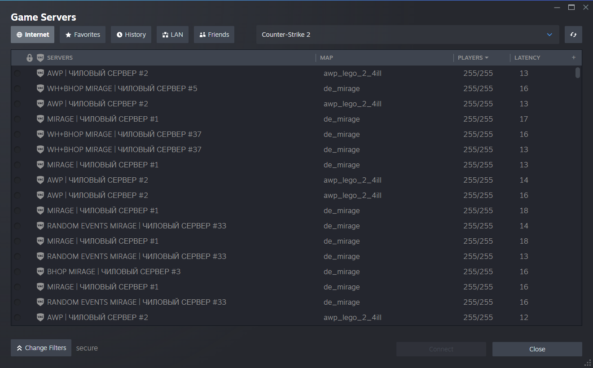
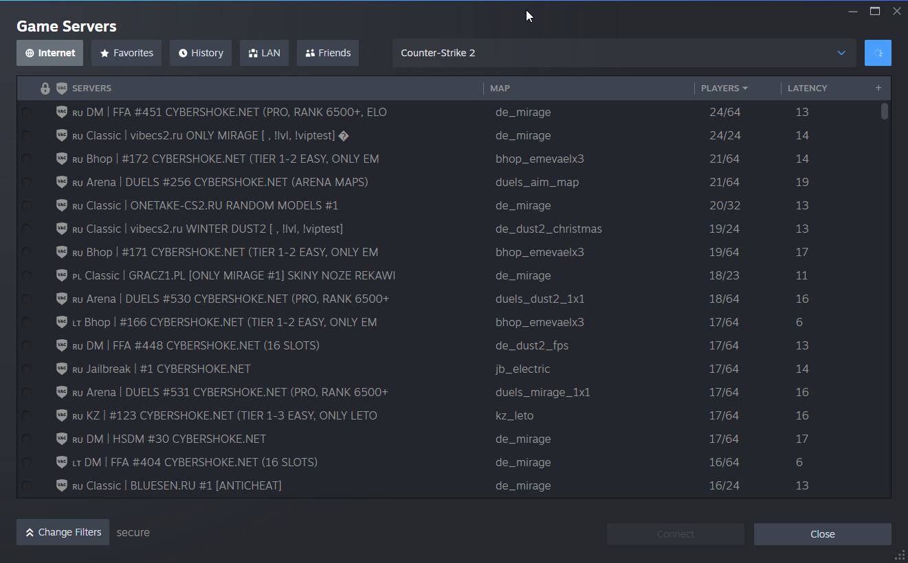
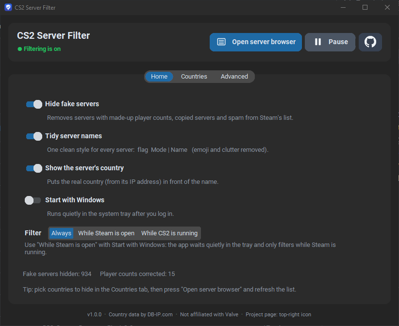

# CS2 Server Browser Fix

Hides fake servers from **Steam's built-in server browser** for CS2 and other Source games, and tidies up the names of the real ones.

Open the browser, refresh, and see real servers instead of lists full of `255/255` players, copies of the same server and spam.

<p align="center"></p>

## Before and after

Steam's server list for Counter-Strike 2, sorted by players. Same list, same moment:

| Without the filter | With the filter |
|:---:|:---:|
|  |  |
| Fake servers fill the top with `255/255` | Real servers with real player counts |

## The app

<p align="center"></p>


## Features

- **Hides fake servers**: impossible player numbers (`255/255`, more players than slots), padded player lists, copies of one server on many ports, spam farms and servers on odd ports.
- **Shows the real player count** when a server only pads its list, and hides it if every listed player is fake.
- **Keeps real servers**, including ones with a few bots.
- **Tidy names**: one style for all servers, `flag  Mode | Name`. The game mode is detected (DM, Retake, Surf, Bhop, ...), emoji clutter and old `[RU]` tags are removed, and the real country comes from the server's IP address.
- **Country filter**: hide or allow whole countries, sorted closest to you first, with flags.
- **Runs in the system tray.** It restarts itself when you change a setting. It can start with Windows and filter only while Steam (or CS2) is running.
- **Open server browser** button, so you can jump straight to Steam's list.

It works with the normal Steam server browser (*View → Game Servers*, or the button in the app). Nothing in the game or Steam is modified.

## Install

1. Download `CS2ServerFilter.exe` from the [latest release](https://github.com/boomix/CS2-server-browser-fix/releases/latest).
2. Run it and accept the Administrator prompt. Packet filtering needs it.
3. Press **Open server browser** and refresh the list.

Windows may show a SmartScreen warning because the file is not code-signed. Choose *More info → Run anyway*. Some antivirus programs dislike packet-filter drivers; the exe is built from the source in this repository (see below).

Settings are stored in `%APPDATA%\CS2ServerFilter`.

## How it works

Steam's server browser asks every server for its info over UDP (Source `A2S_INFO`) and trusts the answer. Fake servers lie in that answer.

The app uses the [WinDivert](https://reqrypt.org/windivert.html) driver to catch those answers on your PC before Steam reads them. Each one is checked:

1. **Sanity**: max players, player count and port must make sense.
2. **Probe**: the app asks the server for its player list (`A2S_PLAYER`) and compares it with the shown count. Padded lists are spotted by identical join times, constant steps and random-case names like `NiNjaHaWk`.
3. **Identity and duplicates**: a server must answer from the port it claims, the same SteamID can't answer from many addresses, and the same name on many IPs is spam.

Fake replies are dropped (the server never appears), and names and player counts of the rest are rewritten. Everything happens locally. The only network traffic added is the player-list probe to servers that are already in your list.

## Limits

- Windows 10/11, IPv4, Source-engine servers. Not signed.
- Fakes that pad fewer than ~10 players can slip through; so can fakes that answer perfectly.
- Mode detection is a guess from the server name and map. Unusual names show as "Custom".
- Steam on Windows may draw flag emoji as two letters. Switch to text style under *Advanced → Names*.
- Use at your own risk. Not affiliated with or endorsed by Valve. It only touches Steam's server-list network traffic, not the game process.

## Build from source

```bash
pip install -r requirements.txt
python src/a2s_filter.py --selftest      # rule tests, no admin needed
python src/a2s_gui.py                    # run the app (elevated)
python build.py                          # builds release/CS2ServerFilter.exe and the zip
```

Engine only, no window: `python src/a2s_filter.py` from an elevated terminal (default settings).

## Credits

Country data: [IP Geolocation by DB-IP](https://db-ip.com) (CC BY 4.0). Flags: [flagcdn.com](https://flagcdn.com). Packet capture: WinDivert. See [THIRD_PARTY_NOTICES.md](THIRD_PARTY_NOTICES.md).

MIT licensed.
